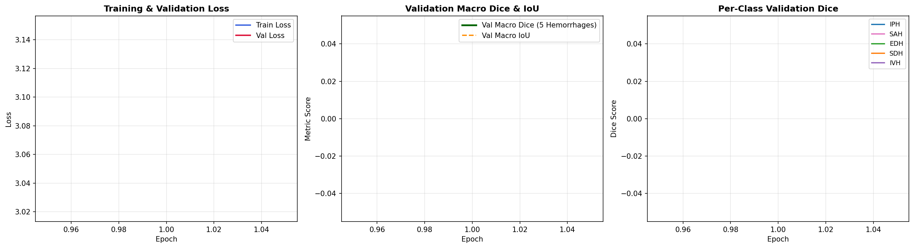
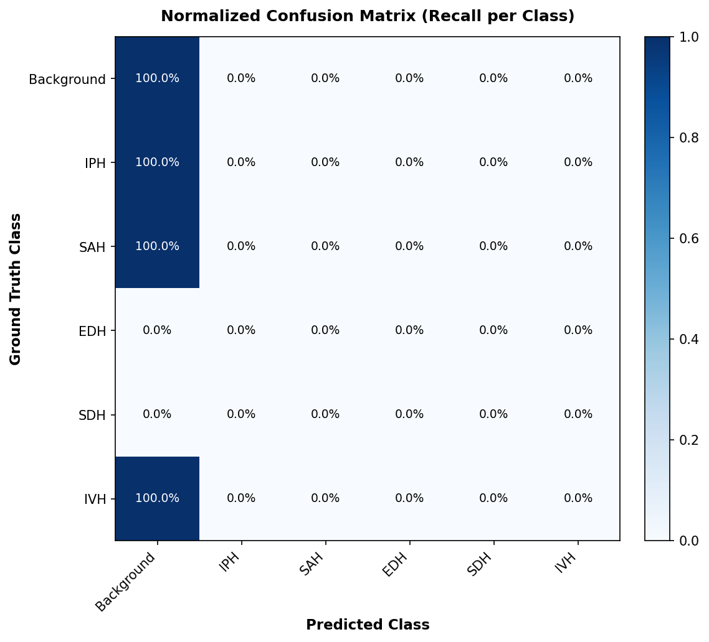
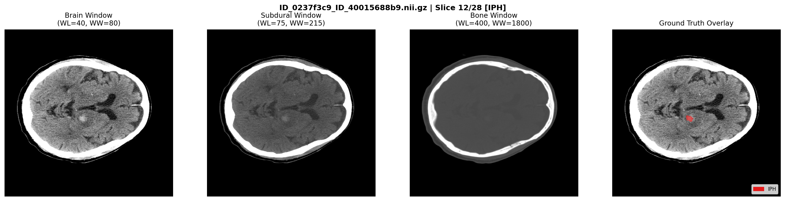
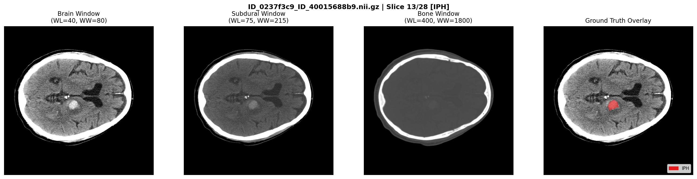
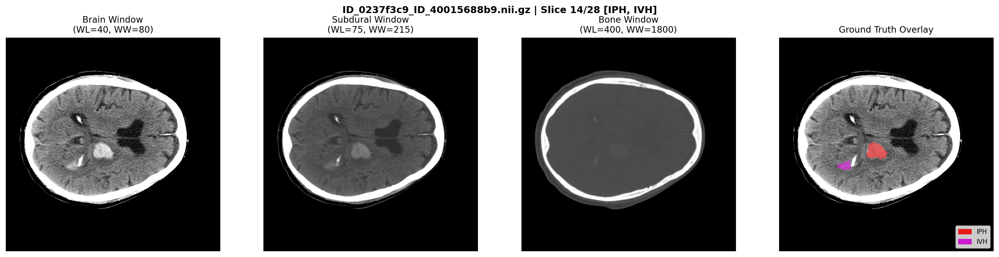
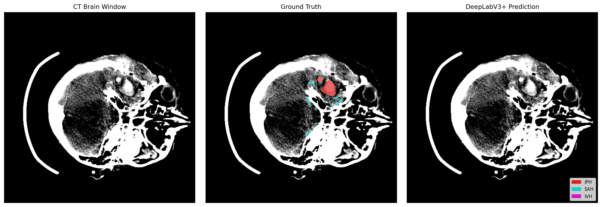
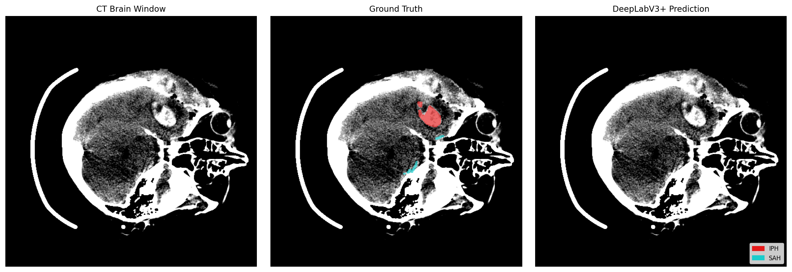
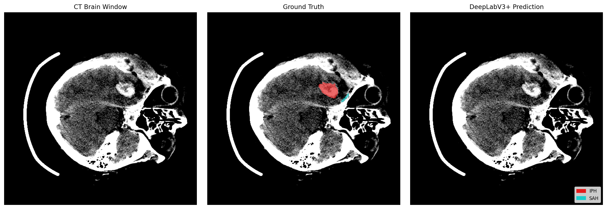
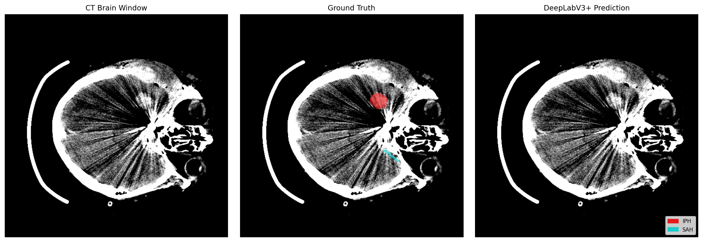
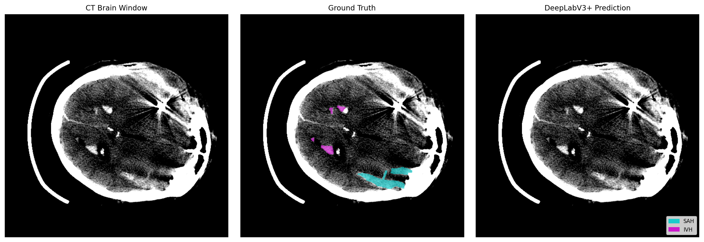

# Brain CT Hemorrhage Segmentation Pipeline Report

## 1. Executive summary

This project implements a multi-class intracranial hemorrhage segmentation pipeline using:

- 3D NIfTI brain CT volumes and voxel-level ground-truth masks.
- Patient-level train/validation/development splitting to prevent leakage.
- A 2.5D input representation: three neighboring CT slices and three clinical CT windows per slice.
- A six-class DeepLabV3+ semantic segmentation model with a ResNet34 encoder.
- A combined weighted cross-entropy and multiclass Dice loss.
- Minority-aware slice sampling, mixed precision, checkpointing, early stopping, and class-wise evaluation.

The completed training run reached its best validation result at **epoch 19**:

| Metric | Result |
|---|---:|
| Hemorrhage macro Dice | **0.4534** |
| Hemorrhage macro IoU | **0.3347** |
| Validation loss | **0.5601** |
| Best epoch | **19** |
| Training stopped | Epoch 31 via early stopping |

The model performed best on IPH and IVH, showed moderate performance on SAH and SDH, and did not successfully segment EDH in the reported validation run.

## 2. Pipeline architecture

```text
NIfTI CT volumes + NIfTI masks
              |
              v
   Dataset discovery and validation
              |
              v
 Patient-level stratified split
   train / validation / development
              |
              v
 For each center slice z:
   use slices z-1, z, z+1
              |
              v
 Apply three HU windows to every slice:
   brain / subdural / bone
              |
              v
 3 slices x 3 windows = 9-channel 2.5D tensor
              |
              v
 Normalization + training augmentations
              |
              v
 Class-aware slice sampler
              |
              v
 DeepLabV3+
 ResNet34 encoder
 9 input channels
 6 output classes
              |
              v
 Weighted Cross-Entropy + Multiclass Soft Dice
              |
              v
 AdamW + cosine learning-rate schedule
 mixed precision + gradient clipping
              |
              v
 Validation metrics and checkpoint selection
              |
              v
 CSV metrics, plots, overlays, checkpoints
```

## 3. Class definition

The model predicts six target classes:

| Target ID | Class | Description |
|---:|---|---|
| 0 | Background | Non-hemorrhage pixels |
| 1 | IPH | Intraparenchymal hemorrhage |
| 2 | SAH | Subarachnoid hemorrhage |
| 3 | EDH | Epidural hemorrhage |
| 4 | SDH | Subdural hemorrhage |
| 5 | IVH | Intraventricular hemorrhage |

The source BHSD labels are remapped into the target ordering before training:

```text
Raw background       -> Target background
Raw intraparenchymal -> Target IPH
Raw subarachnoid     -> Target SAH
Raw epidural         -> Target EDH
Raw subdural         -> Target SDH
Raw intraventricular -> Target IVH
```

## 4. Dataset and split

The run discovered **192 labeled NIfTI image/mask pairs**.

| Split | Volumes | Slices in manifest |
|---|---:|---:|
| Training | 134 | 4,503 |
| Validation | 28 | 924 |
| Development | 30 | 977 |

The split generator:

1. Extracts a patient identifier from each filename.
2. Groups volumes by patient.
3. Stratifies patient groups using hemorrhage presence and rarity.
4. Ensures no volume overlap between splits.
5. Ensures no patient overlap between splits.
6. Saves CSV manifests under `data_splits/`.

During dataset construction, empty training slices are probabilistically filtered. Therefore, the executed training dataset contained **3,502 slices**, while the training manifest contained 4,503 slices.

## 5. Input preprocessing

### 5.1 2.5D slice assembly

For a target slice `z`, the pipeline uses:

```text
previous slice: z - 1
center slice:   z
next slice:     z + 1
```

At volume boundaries, the nearest available slice is repeated.

### 5.2 CT windows

Each slice is rendered through three Hounsfield Unit windows:

| Window | WL | WW | Purpose |
|---|---:|---:|---|
| Brain | 40 | 80 | Brain parenchyma and hemorrhage contrast |
| Subdural | 75 | 215 | Extra-axial and subdural blood |
| Bone | 400 | 1,800 | Bone and high-density structures |

The resulting input shape is:

```text
3 neighboring slices x 3 windows = 9 channels
```

The model input used during training was approximately:

```text
(batch, 9, 512, 512)
```

### 5.3 Augmentation

Training augmentation includes:

- Horizontal flip with probability `0.5`.
- Rotation up to `±15` degrees.
- Intensity jitter limited to `±20 HU`.
- Bilinear interpolation for images.
- Nearest-neighbor interpolation for masks.

## 6. Model architecture

The segmentation model is:

```text
DeepLabV3+
  encoder: ResNet34
  encoder weights: ImageNet pretrained
  input channels: 9
  output classes: 6
  decoder dropout: 0.2
  output: raw logits
```

DeepLabV3+ contains:

1. A ResNet34 encoder that extracts hierarchical spatial features.
2. An atrous spatial pyramid pooling component that captures context at multiple dilation rates.
3. A decoder that combines deep semantic features with earlier spatial features.
4. A six-channel output head producing one logit map per class.
5. Argmax over the class dimension to obtain the predicted segmentation mask.

The notebook also verifies the presence of dropout for Monte Carlo-dropout uncertainty workflows.

The executed smoke test verified:

```text
Input:      (2, 9, 128, 128)
Output:     (2, 6, 128, 128)
Gradients:  valid
NaN/Inf:    none detected
```

## 7. Loss and imbalance handling

The training objective is:

```text
total loss = weighted cross-entropy + multiclass soft Dice loss
```

The training data is strongly imbalanced:

| Class | Pixels | Frequency | Applied weight |
|---|---:|---:|---:|
| Background | 1,176,788,380 | 99.6911% | 1.00 |
| IPH | 1,533,773 | 0.1299% | 25.00 |
| SAH | 521,874 | 0.0442% | 25.00 |
| EDH | 234,378 | 0.0199% | 25.00 |
| SDH | 838,105 | 0.0710% | 25.00 |
| IVH | 517,922 | 0.0439% | 25.00 |

Additional imbalance handling:

- Minority-aware `WeightedRandomSampler`.
- Empty-slice filtering for training.
- Square-root-smoothed inverse-frequency class weighting.
- Maximum class weight capped at `25.0`.

## 8. Training configuration

| Parameter | Value |
|---|---|
| Device | CUDA |
| GPU | NVIDIA RTX PRO 5000 Blackwell |
| GPU memory reported | 47.79 GB |
| PyTorch | 2.11.0+cu128 |
| Python | 3.14.7 |
| Batch size | 8 |
| Maximum epochs | 35 |
| Actual epochs completed | 31 |
| Optimizer | AdamW |
| Learning rate | 3e-4 |
| Minimum learning rate | 1e-5 |
| Weight decay | 1e-4 |
| Gradient clipping | 1.0 |
| Scheduler | CosineAnnealingLR |
| Mixed precision | Enabled |
| Early stopping patience | 12 epochs |
| Random seed | 42 |

The training loop saves:

- `best_model.pth` when validation hemorrhage macro Dice improves.
- `latest_model.pth` after every epoch.
- `training_history.csv` after every epoch.

## 9. Training result

The best checkpoint was saved at **epoch 19**.

| Epoch | Train loss | Validation loss | Macro Dice | Macro IoU |
|---:|---:|---:|---:|---:|
| 1 | 1.0789 | 0.9076 | 0.2532 | 0.1711 |
| 4 | 0.6610 | 0.7763 | 0.3632 | 0.2515 |
| 8 | 0.4687 | 0.6980 | 0.4038 | 0.2943 |
| 10 | 0.3951 | 0.6300 | 0.4295 | 0.3101 |
| 15 | 0.3184 | 0.6004 | 0.4534 | 0.3324 |
| 19 | 0.2672 | 0.5601 | **0.4534** | **0.3347** |
| 24 | 0.2087 | 0.5813 | 0.4443 | 0.3295 |
| 31 | 0.1752 | 0.6204 | 0.4001 | 0.2915 |

Training loss continued to decrease after the best validation result, while validation performance fluctuated and declined. This is consistent with overfitting after approximately epoch 19.

## 10. Final validation metrics

These metrics were computed on the held-out validation set of **28 volumes and 924 slices** using the best checkpoint.

| Class | Dice | IoU | Precision | Recall |
|---|---:|---:|---:|---:|
| Background | 0.9991 | 0.9982 | 0.9991 | 0.9992 |
| IPH | **0.8115** | **0.6828** | 0.7892 | 0.8351 |
| SAH | 0.4136 | 0.2607 | 0.3875 | 0.4435 |
| EDH | 0.0000 | 0.0000 | 0.0000 | 0.0000 |
| SDH | 0.3790 | 0.2338 | 0.4984 | 0.3058 |
| IVH | **0.6630** | **0.4959** | 0.6689 | 0.6572 |
| **Hemorrhage macro average** | **0.4534** | **0.3347** | — | — |

### Interpretation

- **Background** performance is very high, but it should not be used as the main clinical quality indicator because background dominates the pixel count.
- **IPH** is the strongest hemorrhage class in this run.
- **IVH** is also detected reasonably well.
- **SAH** and **SDH** are more difficult, with moderate overlap.
- **EDH** was not detected in the validation output and requires focused investigation.

The EDH result is the most important limitation of this run. Possible causes include very low prevalence, insufficient positive slices, class-label distribution, sampling behavior, or model bias toward more frequent hemorrhage patterns.

## 11. Generated artifacts' outputs

#### Rendered validation metrics CSV

The contents of `validation_metrics.csv` are displayed below:

| Class ID | Hemorrhage Class | Dice | IoU | Precision | Recall |
|---:|---|---:|---:|---:|---:|
| 0 | Background | 0.9991 | 0.9982 | 0.9991 | 0.9992 |
| 1 | IPH | 0.8115 | 0.6828 | 0.7892 | 0.8351 |
| 2 | SAH | 0.4136 | 0.2607 | 0.3875 | 0.4435 |
| 3 | EDH | 0.0000 | 0.0000 | 0.0000 | 0.0000 |
| 4 | SDH | 0.3790 | 0.2338 | 0.4984 | 0.3058 |
| 5 | IVH | 0.6630 | 0.4959 | 0.6689 | 0.6572 |

#### Rendered training history CSV

The main columns from `training_history.csv` are rendered below. The complete CSV, including per-class recall and background metrics, is available through the link above.

| Epoch | Train loss | Validation loss | Macro Dice | Macro IoU | Learning rate |
|---:|---:|---:|---:|---:|---:|
| 1 | 1.0789 | 0.9076 | 0.2532 | 0.1711 | 0.000299 |
| 2 | 0.8100 | 0.8971 | 0.3242 | 0.2227 | 0.000298 |
| 3 | 0.7289 | 0.9222 | 0.3181 | 0.2121 | 0.000295 |
| 4 | 0.6610 | 0.7763 | 0.3632 | 0.2515 | 0.000291 |
| 5 | 0.5713 | 0.7636 | 0.3072 | 0.2068 | 0.000286 |
| 6 | 0.5261 | 0.7202 | 0.3654 | 0.2563 | 0.000279 |
| 7 | 0.4881 | 0.6854 | 0.3974 | 0.2845 | 0.000272 |
| 8 | 0.4687 | 0.6980 | 0.4038 | 0.2943 | 0.000264 |
| 9 | 0.4365 | 0.6843 | 0.4114 | 0.2903 | 0.000255 |
| 10 | 0.3951 | 0.6300 | 0.4295 | 0.3101 | 0.000245 |
| 11 | 0.4013 | 0.6284 | 0.3956 | 0.2860 | 0.000235 |
| 12 | 0.3752 | 0.6515 | 0.4087 | 0.2949 | 0.000224 |
| 13 | 0.3553 | 0.6366 | 0.4027 | 0.2906 | 0.000212 |
| 14 | 0.3361 | 0.6221 | 0.3933 | 0.2850 | 0.000200 |
| 15 | 0.3184 | 0.6004 | **0.4534** | **0.3324** | 0.000187 |
| 16 | 0.3063 | 0.6170 | 0.4045 | 0.2932 | 0.000174 |
| 17 | 0.2878 | 0.6316 | 0.4263 | 0.3056 | 0.000162 |
| 18 | 0.2768 | 0.5957 | 0.4148 | 0.3030 | 0.000148 |
| 19 | 0.2672 | 0.5601 | **0.4534** | **0.3347** | 0.000136 |
| 20 | 0.2592 | 0.5922 | 0.4275 | 0.3141 | 0.000123 |
| 21 | 0.2363 | 0.5924 | 0.4088 | 0.3016 | 0.000110 |
| 22 | 0.2368 | 0.6189 | 0.3958 | 0.2930 | 0.000098 |
| 23 | 0.2218 | 0.5978 | 0.4164 | 0.3067 | 0.000086 |
| 24 | 0.2087 | 0.5813 | 0.4443 | 0.3295 | 0.000075 |
| 25 | 0.2078 | 0.5959 | 0.4322 | 0.3168 | 0.000065 |
| 26 | 0.1983 | 0.6038 | 0.3966 | 0.2885 | 0.000055 |
| 27 | 0.1973 | 0.6088 | 0.4100 | 0.2994 | 0.000046 |
| 28 | 0.1906 | 0.6148 | 0.4076 | 0.2980 | 0.000038 |
| 29 | 0.1763 | 0.6038 | 0.4156 | 0.3021 | 0.000031 |
| 30 | 0.1746 | 0.6041 | 0.4135 | 0.3028 | 0.000024 |
| 31 | 0.1752 | 0.6204 | 0.4001 | 0.2915 | 0.000019 |


### Output images

#### Training curves



#### Confusion matrix



#### Dataset inspection







#### Prediction overlays











