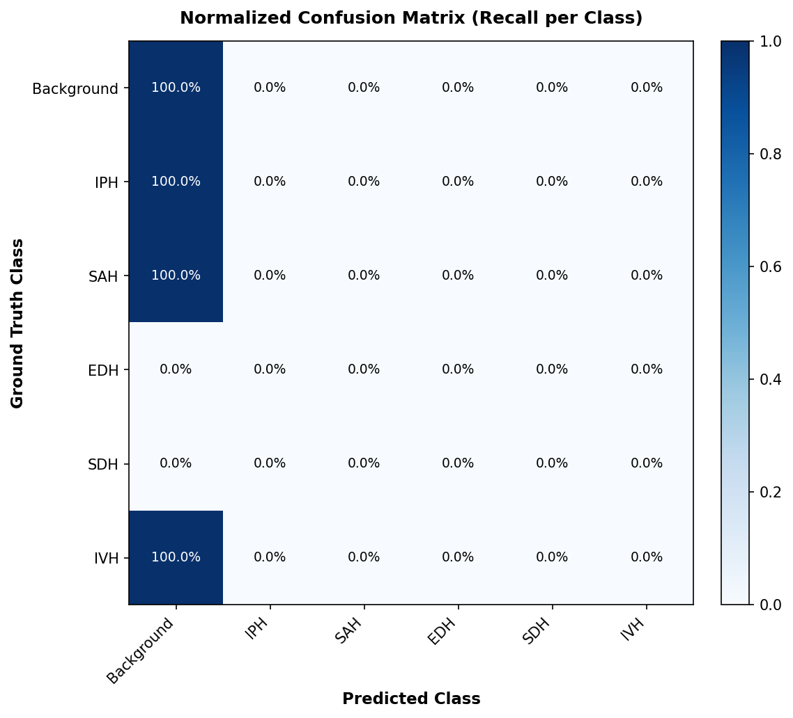

# Brain CT Hemorrhage Segmentation Baseline Evaluation

| Class ID | Hemorrhage Class | Dice | IoU | Precision | Recall |
|:---:|:---|:---:|:---:|:---:|:---:|
| 0 | Background | 0.9993 | 0.9987 | 0.9987 | 1.0000 |
| 1 | IPH | 0.0000 | 0.0000 | 0.0000 | 0.0000 |
| 2 | SAH | 0.0000 | 0.0000 | 0.0000 | 0.0000 |
| 3 | EDH | 0.0000 | 0.0000 | 0.0000 | 0.0000 |
| 4 | SDH | 0.0000 | 0.0000 | 0.0000 | 0.0000 |
| 5 | IVH | 0.0000 | 0.0000 | 0.0000 | 0.0000 |

**Macro Dice (5 hemorrhage classes, excl. BG):** `0.0000`
**Macro IoU (5 hemorrhage classes, excl. BG):** `0.0000`

## Confusion Matrix

